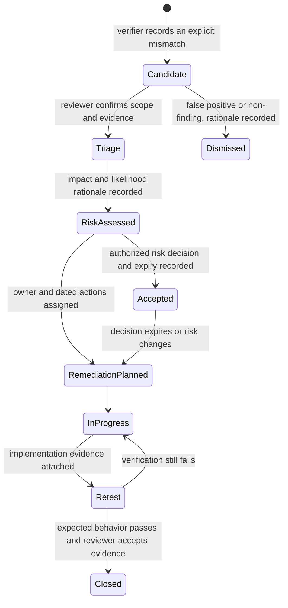

# Security finding and remediation workflow

This workflow connects a failed verification result to a reviewed finding,
risk decision, corrective action, and retest. It supports engineering
traceability; it does not assert that a control is satisfied or that the
platform has received an authorization.

## Record lifecycle



The suite runner's `candidate-findings.json` is an observation queue. A
candidate is not yet a confirmed vulnerability, control failure, or risk
acceptance. Keep source evidence immutable; create a reviewed finding record
that points to the candidate and its detailed suite report.

The local tool `local-lab/scripts/manage-security-findings.py` imports
candidate files into a private register and records allowed status transitions.
It is an offline file operation; it does not call Kubernetes, Rancher,
Keycloak, or a notification service. The default register is
`.secrets/security-findings-register.json` (mode `0600`). The path can be
overridden with `--register`; an overridden path must also be kept in
access-controlled storage. The tool refuses an existing register readable by
group or other users. A neighboring mode-0600 lock file serializes local
writers.

```sh
python3 local-lab/scripts/manage-security-findings.py import-candidates \
  local-lab/evidence/tenant-suite/<run>/candidate-findings.json
python3 local-lab/scripts/manage-security-findings.py list --status candidate
python3 local-lab/scripts/manage-security-findings.py transition PF-2026-0001 \
  --to triage --actor "reviewer-id" --rationale "Reviewed source report"
python3 local-lab/scripts/manage-security-findings.py transition PF-2026-0001 \
  --to risk-assessed --actor "assessor-id" --rationale "Risk reviewed" \
  --impact-rationale "Describe plausible impact" \
  --likelihood-rationale "Describe likelihood and evidence" \
  --residual-risk-rationale "Describe remaining exposure"
```

Imports are idempotent for the same candidate artifact and content. They
preserve candidates as candidates, assign a local register ID, and do not
change the input evidence. Every transition requires an actor and rationale.
Risk assessment requires impact and likelihood rationale but computes no
score; residual-risk rationale is also required. Risk acceptance requires a
named decision authority and future review date. Planning remediation requires
an owner and due date. Closure requires a passing retest and evidence
reference. A failed retest can return the record to in-progress, and a later
failed retest can reopen a closed record.

This local JSON file is not a multi-user system of record: its lock protects
concurrent local commands only. Do not put the private register in public Git.
If findings need team review, move the sanitized records to an approved private
workflow with access controls, history protection, backup, and retention.

## Required review and record fields

Use [`templates/security-finding.yaml`](templates/security-finding.yaml) as a
copyable record skeleton. Do not populate unknowns with guesses. Record:

- Stable finding ID, current status, discovery and review timestamps.
- Affected cluster, tenant, namespace, component, and environment where known.
- Concise condition, expected behavior, observed behavior, and reproducible
  verification procedure.
- Evidence artifact paths and the source candidate ID; redact credentials and
  secret values from evidence before sharing it.
- Potential control mappings, with rationale and applicability reviewed by a
  qualified assessor. A mapping is traceability, not a control-satisfaction
  claim.
- Reviewer, accountable risk owner, remediation owner, and dated actions.
- Likelihood and impact rationale, existing safeguards, inherent and residual
  risk decisions, and the authority for any acceptance.
- Retest procedure, result, timestamp, evidence, and independent reviewer for
  closure.

Risk ratings are specific to the system boundary and decision authority. This
repository does not set an enterprise risk matrix or assign severity
automatically. If an organization uses numeric likelihood/impact scales, store
the scale name and rationale; do not infer risk from a test's pass/fail or
control mapping. Risk acceptance must identify the authorized decision maker
and review/expiry date. A developer cannot accept risk on behalf of the system
owner.

## Decision rules

1. **Triage:** verify the report is from the intended cluster and time, inspect
   the underlying detailed evidence, reproduce when safe, and identify whether
   the mismatch is a security condition, test defect, configuration drift, or
   environmental error. Preserve the original evidence either way.
2. **Confirm or dismiss:** confirmed conditions move to risk assessment. A
   dismissed candidate retains a rationale and reviewer; never delete it just
   because it is inconvenient or a later run passes.
3. **Assess risk:** record affected assets and tenants, plausible impact,
   likelihood rationale, safeguards, uncertainty, and residual risk. Map
   controls only after reviewing applicability and shared responsibility.
4. **Plan and remediate:** assign an accountable owner and dated, verifiable
   actions. Link change requests or commits. Keep mitigations distinct from
   permanent correction.
5. **Retest:** repeat the original procedure against the intended environment
   and attach timestamped evidence. A code change alone is not closure.
6. **Close:** an authorized reviewer confirms the condition is corrected or
   formally dispositioned under the organization's process. Record residual
   risk and any monitoring needed. Accepted risk remains open with an expiry
   or review date; it is not marked remediated.

## Local lab evidence handling

`local-lab/scripts/run-tenant-security-suite.py --apply` writes timestamped
run summaries and candidate findings under ignored `local-lab/evidence/`.
That location is intentionally not published automatically: live evidence can
contain environment details. Review and redact artifacts before deciding
whether any belong in version control. Never commit secrets, access tokens,
personal data, or unreviewed raw cluster output.

The register records reviewed decisions and assignments but does not calculate
risk, page operators, or close findings automatically. Phase 6 runtime
acceptance must also verify the schedule, evidence retention, alerting, and
failure handling on suitable ThinkCentre hardware; no recurring live
assessment is enabled by this document.

## NIST traceability

Potential mappings such as AC-3, AC-4, AC-6, CM-6, SC-6, SC-7, SC-39, and CA-7
must be validated against the actual system boundary, control implementation,
inherited/shared responsibilities, and assessment procedure. Use the
[control-evidence matrix](CONTROL-EVIDENCE-MATRIX.md) to link implementation
and verification evidence. These engineering records are not an SSP, SAR, ATO,
FedRAMP authorization, CMMC assessment, or DoD authorization decision.
